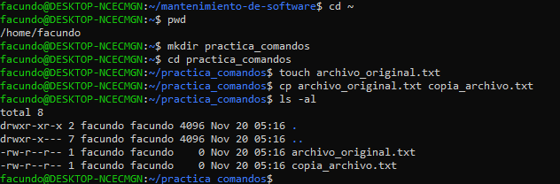
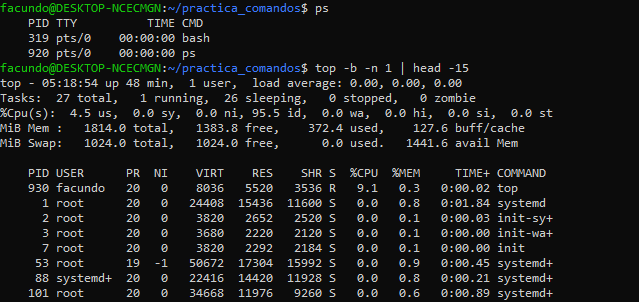
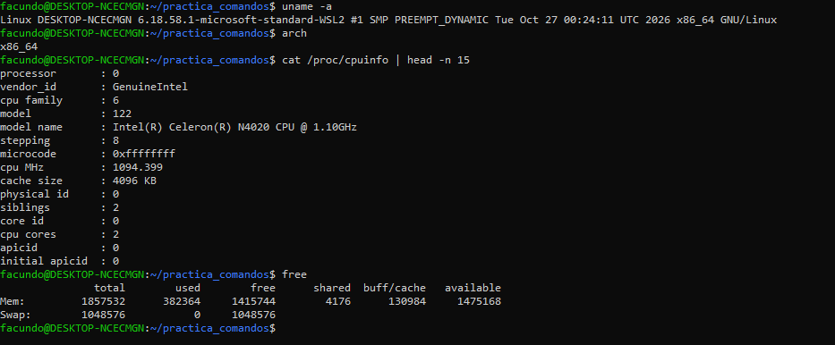
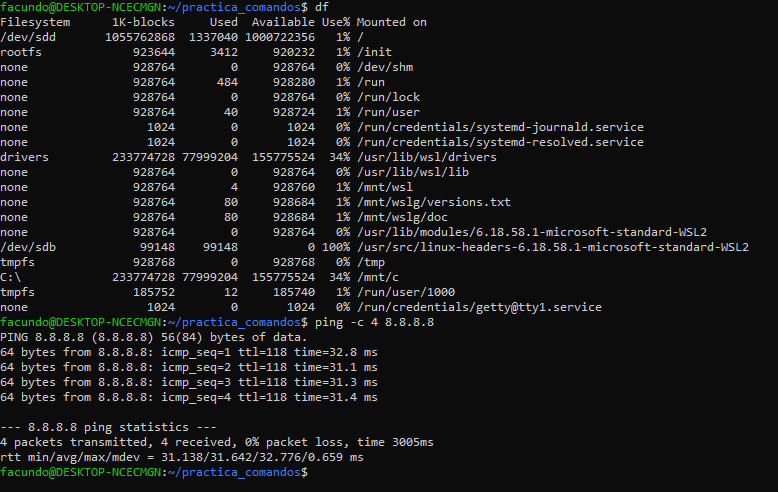

# TP: Comandos Básicos, Procesos y Utilidades en Linux

* **Materia:** Mantenimiento de Software
* **Estudiante:** Facundo Mauricio Cruz Mendez
* **Fecha de Entrega:** 2026

---

## 1. Gestión de Archivos y Directorios

Comandos ejecutados: `pwd`, `mkdir practica_comandos`, `cd practica_comandos`, `touch archivo_original.txt`, `cp archivo_original.txt copia_archivo.txt`, `ls -al`

* **Explicación de `ls -al`:** `ls` simple muestra solo los nombres de los archivos y directorios visibles. `ls -al` combina dos opciones: `-l` (formato largo, con permisos, propietario, grupo, tamaño y fecha de modificación) y `-a` (muestra también los archivos ocultos, incluyendo `.` y `..`).

---

## 2. Monitoreo de Procesos

Comandos ejecutados: `ps` y `top`

* **Diferencia entre `ps` y `top`:** `ps` sin opciones muestra una foto estática de los procesos de la terminal actual (PID, terminal, tiempo de CPU y comando) y termina. `top` es interactivo: se actualiza continuamente y muestra todos los procesos del sistema con su uso de CPU y memoria, ordenados por consumo, además de un resumen general (carga, memoria, tareas).
* **Uso de `kill`:** `kill pid` envía una señal al proceso con ese PID. Por defecto envía SIGTERM, que le pide terminar de forma ordenada. Si un programa está colgado y no responde, se puede usar `kill -9 pid` (SIGKILL) para forzar su cierre.

---

## 3. Información del Sistema

Comandos ejecutados: `uname -a`, `arch`, `cat /proc/cpuinfo`, `free`

* **Detalles del Kernel y Memoria:** `uname -a` muestra el nombre del kernel (Linux), el nombre del equipo, la versión y fecha de compilación del núcleo, la arquitectura del hardware y el sistema operativo. `free` muestra el uso de la memoria: total, usada, libre, compartida, caché/buffers y disponible, además del espacio de swap.

---

## 4. Red y Espacio en Disco

Comandos ejecutados: `df`, `ping -c 4 8.8.8.8`

* **Funcionamiento de `ping`:** `ping` envía paquetes ICMP (echo request) a una dirección IP y espera la respuesta (echo reply). Su objetivo principal es verificar la conectividad entre dos equipos de una red TCP/IP y medir el tiempo de respuesta (latencia) y la pérdida de paquetes. Con `-c 4` se envían solo 4 paquetes.
