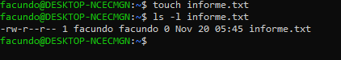
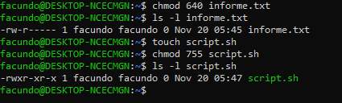
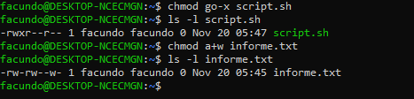
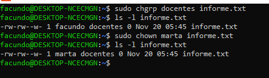
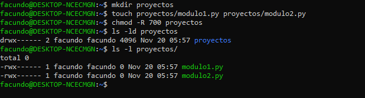

# TP: Permisos de Archivos, Directorios y Propiedad en Linux

* **Materia:** Mantenimiento de Software
* **Estudiante:** Facundo Mauricio Cruz Mendez
* **Fecha de Entrega:** 2026

---

## 1. Lectura e Interpretación de Permisos (`ls -l`)

Comandos ejecutados: `touch informe.txt`, `ls -l informe.txt`

El primer carácter indica el tipo de elemento: `-` archivo regular, `d` directorio, `l` enlace simbólico. Los 9 caracteres siguientes son tres grupos de tres permisos: `r` = lectura, `w` = escritura, `x` = ejecución (o acceso, en directorios). Un guion (`-`) indica que ese permiso no está concedido.

| Posición | Representación | Significado / Permiso |
| :--- | :--- | :--- |
| Tipo | `-` / `d` / `l` | Archivo regular / directorio / enlace simbólico |
| Propietario (`u`) | `rwx` | Permisos del dueño del archivo: leer, escribir y ejecutar |
| Grupo (`g`) | `rwx` | Permisos de los usuarios que pertenecen al grupo del archivo |
| Otros (`o`) | `rwx` | Permisos del resto de los usuarios del sistema |

---

## 2. Permisos en Modo Octal

Comandos ejecutados: `chmod 640 informe.txt`, `touch script.sh`, `chmod 755 script.sh`, y `ls -l` de cada uno.

* **Desglose numérico $640$:** $r(4)+w(2) = 6$ \| $r(4) = 4$ \| $- = 0$ → `rw-r-----`
* **Desglose numérico $755$:** $r(4)+w(2)+x(1) = 7$ \| $r(4)+x(1) = 5$ \| $r(4)+x(1) = 5$ → `rwxr-xr-x`

---

## 3. Modo Simbólico

Comandos ejecutados: `chmod go-x script.sh`, `chmod a+w informe.txt`, y `ls -l` de cada uno.

* **Ventaja del modo simbólico:** Permite modificar un permiso puntual sin tocar los demás y sin tener que calcular el número completo. Con el modo octal hay que indicar siempre los tres valores, así que es fácil sobrescribir permisos sin querer; con `chmod go-x` solo se quita la ejecución a grupo y otros y el resto queda igual.

---

## 4. Cambio de Propietario y Grupo

Comandos ejecutados: `sudo chgrp docentes informe.txt`, `sudo chown marta informe.txt`, y `ls -l` de cada uno.

* **¿Por qué se requiere privilegio superusuario para `chown`?:** Porque cambiar el propietario de un archivo es una operación restringida a root. Si cualquier usuario pudiera cederle archivos a otro, podría eludir cuotas de disco, atribuir archivos a otra persona o dejar archivos con permisos especiales a nombre de otra cuenta. Por eso solo el administrador puede hacerlo.

---

## 5. Permisos Recursivos en Directorios

Comandos ejecutados: `mkdir proyectos`, `touch proyectos/modulo1.py proyectos/modulo2.py`, `chmod -R 700 proyectos`, `ls -ld proyectos`, `ls -l proyectos/`

* **Importancia del permiso `x` en un directorio:** En un directorio, `x` significa poder acceder a él: entrar con `cd` y llegar a los archivos que contiene (por nombre). Si se quita, aunque se tenga permiso de lectura no se puede entrar al directorio ni acceder a su contenido, y los comandos que operan sobre sus archivos fallan con "Permiso denegado".
* **Nota sobre `700`:** Con `-R` el permiso `rwx------` se aplica a la carpeta y a los archivos que contiene, de modo que solo el propietario puede leer, escribir y ejecutar.
