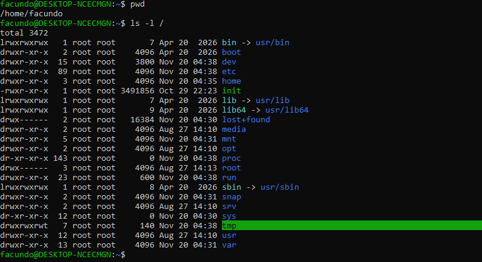
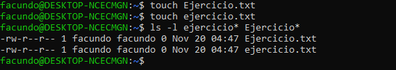
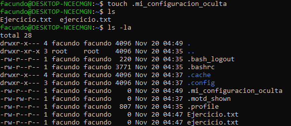
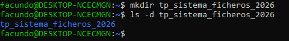
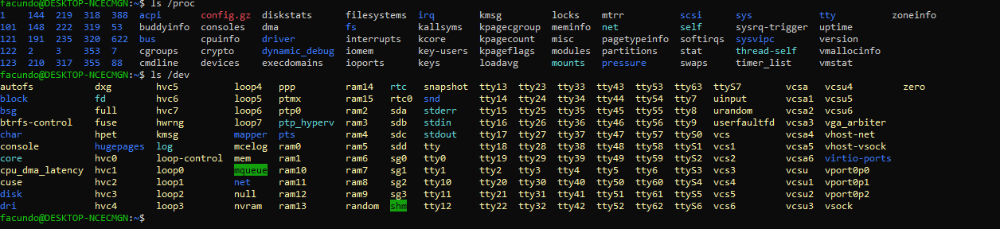

# TP: Sistema de Archivos en Linux

* **Materia:** Mantenimiento de Software
* **Estudiante:** Facundo Mauricio Cruz Mendez
* **Fecha de Entrega:** 2026
* **Profesor:** Gabriel Artaza

---

## 1. Estructura del Árbol de Directorios

Comando ejecutado: `ls -l /`

| Directorio | Función según la guía |
| :--- | :--- |
| `/etc` | Archivos de configuración de la mayoría de los programas. |
| `/home` | Archivos personales de los usuarios. |
| `/dev` | Archivos simbólicos que representan hardware. |
| `/var` | Datos variables como registros (logs) y bases de datos. |

---

## 2. Sensibilidad a Mayúsculas y Minúsculas

Comandos ejecutados: `touch Ejercicio.txt`, `touch ejercicio.txt`, `ls -l ejercicio* Ejercicio*`

*Respuesta:* En Linux el sistema de archivos distingue mayúsculas de minúsculas (es *case sensitive*), por lo que `Ejercicio.txt` y `ejercicio.txt` son nombres distintos y pueden coexistir en la misma carpeta. En Windows, en cambio, no se distingue entre mayúsculas y minúsculas: ambos nombres se consideran el mismo y el segundo no se puede crear.

---

## 3. Visualización y Gestión de Archivos Ocultos

Comandos ejecutados: `touch .mi_configuracion_oculta`, `ls`, `ls -la`

*Explicación:* Los archivos y directorios cuyo nombre empieza con un punto (`.`) quedan ocultos en los listados comunes (`ls` no los muestra; `ls -la` sí). Sirven para guardar configuraciones de usuario y de programas (por ejemplo `.bashrc`) sin ensuciar la vista habitual y evitando modificaciones accidentales.

---

## 4. Buenas Prácticas en Nombres de Archivos

Comando ejecutado: `mkdir tp_sistema_ficheros_2026`

*Justificación:* `tp_sistema_ficheros_2026` cumple las recomendaciones porque está en minúsculas, usa guiones bajos en lugar de espacios y no tiene acentos, "ñ" ni caracteres especiales. Eso evita problemas en la terminal y en scripts.

En cambio, `TP Sistema de Ficheros (Año 2026)!.doc` no las cumple: tiene espacios (obligan a usar comillas o escapes), paréntesis y signo de exclamación (que la shell interpreta de forma especial), la letra "ñ" y mayúsculas mezcladas.

---

## 5. Exploración de Dispositivos y Procesos

Comandos ejecutados: `ls /proc`, `ls /dev`

*Explicación:* `/proc` es un sistema de archivos virtual que expone información del kernel y de los procesos en ejecución. Cada proceso tiene una carpeta numerada con su PID, y hay archivos con datos del sistema como `cpuinfo` (procesador) y `meminfo` (memoria). Su contenido se genera en tiempo real y no ocupa espacio en disco.
