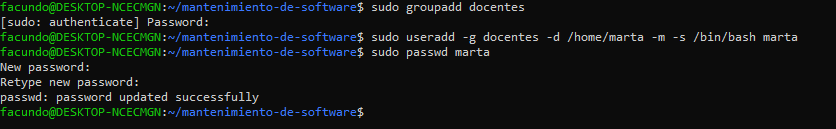
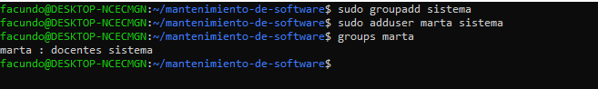
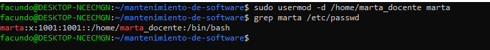
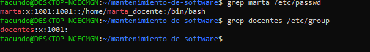
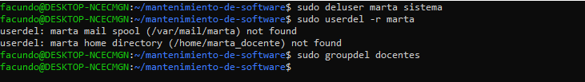

# TP: Administración de Usuarios y Grupos en Linux

* **Materia:** Mantenimiento de Software
* **Estudiante:** Facundo Mauricio Cruz Mendez
* **Fecha de Entrega:** 2026

---

## 1. Creación de Grupos y Usuarios

Comandos ejecutados:

```bash
sudo groupadd docentes
sudo useradd -g docentes -d /home/marta -m -s /bin/bash marta
sudo passwd marta
```



* **Explicación del parámetro `-m`:** Le indica a `useradd` que cree automáticamente el directorio personal del usuario (en este caso `/home/marta`) y copie en él los archivos de configuración base de `/etc/skel`. Si se omite, la cuenta se crea igualmente pero el directorio home no existe, por lo que el usuario no tendría dónde guardar sus archivos ni su configuración y podrían aparecer errores al iniciar sesión.

---

## 2. Gestión de Grupos Secundarios

Comandos ejecutados:

```bash
sudo groupadd sistema
sudo adduser marta sistema
groups marta
```



* **Comando para quitar usuario de un grupo:** `sudo deluser marta sistema` (también se puede usar `sudo gpasswd -d marta sistema`).

---

## 3. Modificación de Usuarios

Comando ejecutado:

```bash
sudo usermod -d /home/marta_docente marta
```



* **Diferencia entre `useradd` y `usermod`:** `useradd` sirve para crear una cuenta nueva, mientras que `usermod` modifica los parámetros de una cuenta que ya existe (directorio home, shell, grupos, etc.). Nota: `usermod -d` solo cambia la ruta registrada; para mover el contenido hay que agregar la opción `-m`.

---

## 4. Ficheros de Configuración

Comandos ejecutados:

```bash
grep marta /etc/passwd
grep docentes /etc/group
```



| Fichero | Contenido / Función |
| :--- | :--- |
| `/etc/passwd` | Información de las cuentas de usuario, una por línea: nombre, UID, GID del grupo principal, comentario, directorio home y shell. |
| `/etc/group` | Información de los grupos: nombre, GID y lista de usuarios que pertenecen a cada grupo como secundarios. |
| `/etc/shadow` | Contraseñas de los usuarios en formato cifrado (hash) y datos de caducidad. Solo root puede leerlo, por seguridad. |

---

## 5. Eliminación de Usuarios y Grupos

Comandos ejecutados:

```bash
sudo deluser marta sistema
sudo userdel -r marta
sudo groupdel docentes
```



* **Uso del parámetro `-r` en `userdel`:** Elimina la cuenta del usuario y, además, borra su directorio home y su buzón de correo. Sin `-r`, solo se elimina la cuenta y los archivos quedan en disco.
* **Condición para borrar un grupo con `groupdel`:** El grupo no puede ser el grupo primario de ningún usuario existente. Primero hay que eliminar esos usuarios o cambiarles el grupo principal; por eso se borra `marta` antes que `docentes`.
